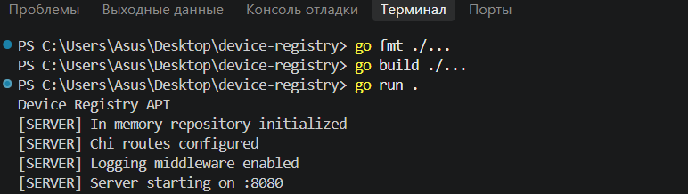
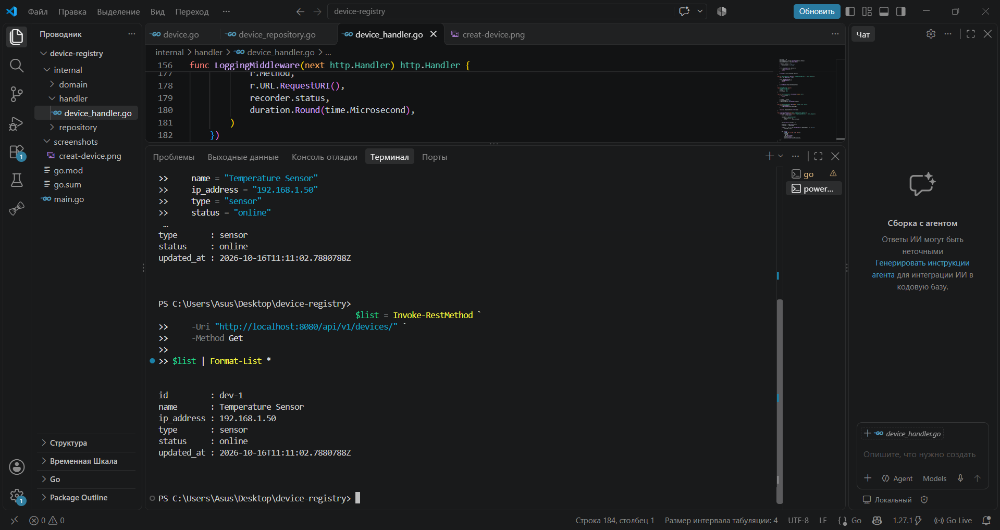
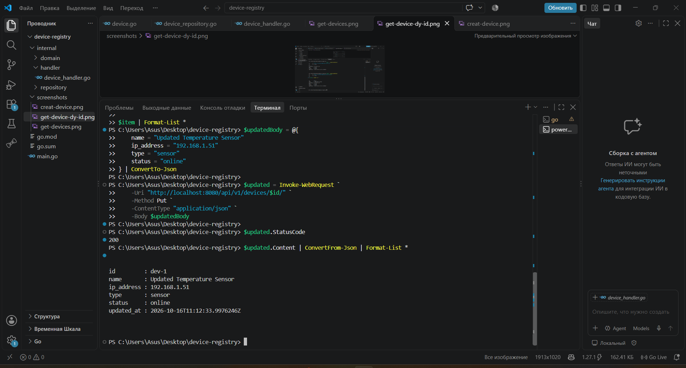
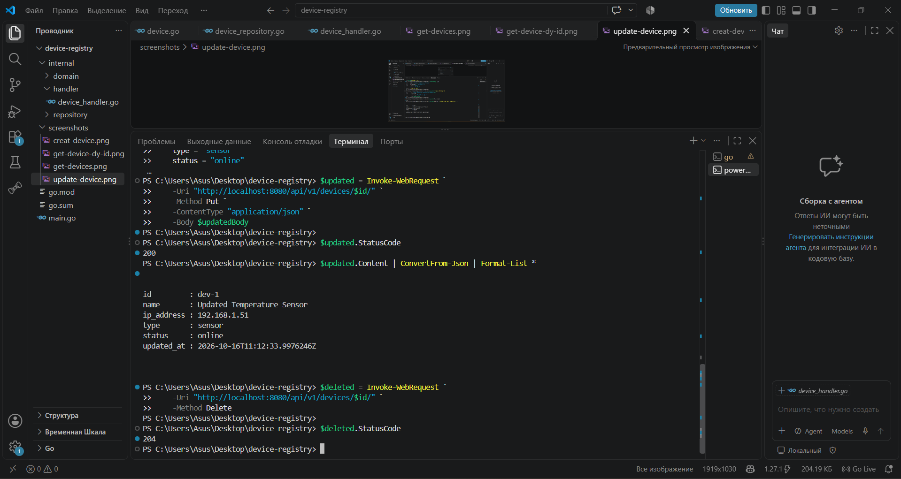
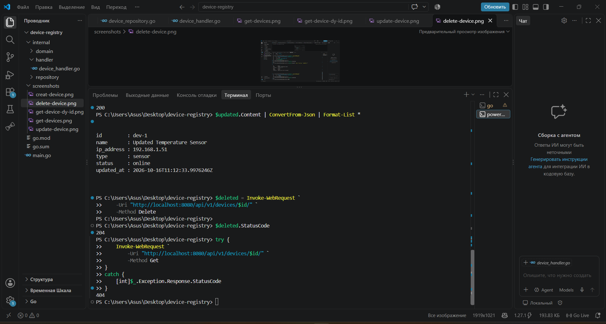
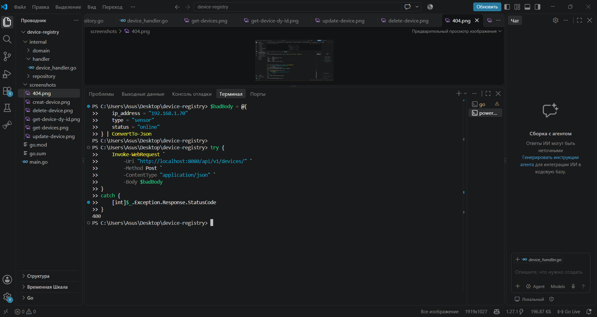
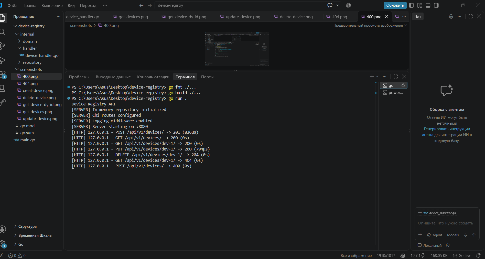

# Практична робота №4 — Device Registry API

## Тема
Побудова REST API з використанням маршрутизатора Chi.

## Мета роботи
Опанувати принципи проєктування REST API, роботу з HTTP-методами, маршрутизатором `go-chi/chi/v5`, потокобезпечним сховищем `sync.RWMutex` та Middleware логування.

## Виконаний рівень
**Рівень 1 і рівень 2 — повний REST CRUD та Middleware логування.**

## Використані технології
- Go
- Chi Router (`github.com/go-chi/chi/v5`)
- `net/http`
- `sync.RWMutex`
- JSON
- PowerShell для тестування HTTP-запитів

## Структура проєкту

```text
device-registry/
├── go.mod
├── go.sum
├── main.go
├── internal/
│   ├── domain/
│   │   └── device.go
│   ├── repository/
│   │   └── device_repository.go
│   └── handler/
│       └── device_handler.go
├── screenshots/
└── README.md
```

## Реалізований функціонал

- Створення пристроїв.
- Отримання списку пристроїв.
- Отримання пристрою за ID.
- Оновлення даних пристрою.
- Видалення пристрою.
- Перевірка обов'язкових полів під час створення й оновлення.
- Потокобезпечне зберігання даних у `map` із використанням `sync.RWMutex`.
- Middleware логування HTTP-методу, шляху, статусу відповіді та тривалості запиту.

## API-ендпоінти

| HTTP-метод | URL | Призначення | Статус |
|---|---|---|---|
| GET | `/api/v1/devices/` | Отримання всіх пристроїв | 200 OK |
| POST | `/api/v1/devices/` | Створення пристрою | 201 Created |
| GET | `/api/v1/devices/{id}/` | Отримання пристрою за ID | 200 OK / 404 Not Found |
| PUT | `/api/v1/devices/{id}/` | Оновлення пристрою | 200 OK / 404 Not Found |
| DELETE | `/api/v1/devices/{id}/` | Видалення пристрою | 204 No Content / 404 Not Found |

## Запуск програми

Для запуску необхідно мати встановлений Go SDK.

У терміналі з кореневої папки проєкту виконати:

```powershell
go mod tidy
go fmt ./...
go build ./...
go run .
```

Сервер запускається за адресою:

`http://localhost:8080`

## Тестування програми

### 1. Запуск сервера



### 2. Створення пристрою — POST, 201 Created


### 3. Отримання списку пристроїв — GET, 200 OK



### 4. Отримання пристрою за ID — GET, 200 OK


### 5. Оновлення пристрою — PUT, 200 OK



### 6. Видалення пристрою — DELETE, 204 No Content



### 7. Перевірка відсутності пристрою після видалення — 404 Not Found



### 8. Перевірка валідації даних — 400 Bad Request



### 9. Middleware логування HTTP-запитів



## Результати перевірки

Під час тестування перевірено життєвий цикл пристрою:

1. Створення пристрою — `201 Created`.
2. Отримання списку пристроїв — `200 OK`.
3. Отримання пристрою за ID — `200 OK`.
4. Оновлення пристрою — `200 OK`.
5. Видалення пристрою — `204 No Content`.
6. Повторне отримання видаленого пристрою — `404 Not Found`.
7. Створення пристрою без обов'язкового поля — `400 Bad Request`.

## Висновок

У результаті виконання практичної роботи створено REST API реєстру мережевих пристроїв на мові Go з використанням маршрутизатора Chi. Реалізовано CRUD-операції, потокобезпечне сховище на основі `sync.RWMutex`, перевірку вхідних даних і Middleware логування HTTP-запитів. Роботу сервера перевірено за допомогою PowerShell. Отримані результати підтверджують працездатність реалізованого функціоналу рівнів 1 і 2.
